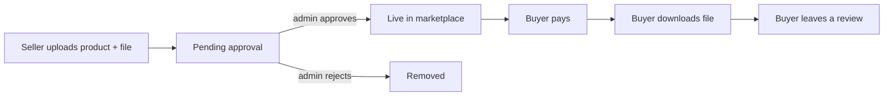

# AppBazaar

A digital marketplace where developers and studios sell software, apps, website templates, AI tools and services, and buyers pay and download what they bought.

Built with **Spring Boot 3 (Java 21)**, **PostgreSQL** and **React (Vite)**.


## Features

- **Registration fee.** Every new buyer and seller pays a one-time $5 fee (simulated for now) before the account is active. The admin panel shows the fee income.
- **Three roles.** Buyer, seller and admin, with JWT login (passwords hashed with BCrypt) and role-based access on every endpoint.
- **Seller uploads.** A seller lists a product together with the file buyers will receive (zip, rar, 7z, tar, gz, pdf, apk, jar, txt, md, up to 50 MB).
- **Admin approval.** New listings wait in an approval queue. The admin can download the file to review it, then approve or reject. Only approved products are public.
- **Cart and checkout.** Prices are always read from the database, never from the browser. Payment is simulated for now.
- **Protected downloads.** Only a buyer who paid, the product's seller, or an admin can download a file. Files are stored under random names.
- **Real reviews.** Only buyers of a product can review it. A product's rating is the average of its real reviews.
- **Student projects group.** College and mini projects live together on a Projects page, with a separate Register your project form (tech stack, college, price and file).
- **Search and filters**, light and dark theme, and a responsive layout.

| Seller upload | Admin approval | Buyer downloads |
|---|---|---|
|  |  |  |

## How it works



## Tech stack

| Layer | Tools |
|---|---|
| Backend | Java 21, Spring Boot 3.3, Spring Security, Spring Data JPA (Hibernate), JJWT |
| Database | PostgreSQL |
| Frontend | React 18, React Router, Vite |
| CI | GitHub Actions (builds backend and frontend on every push) |

## Run it locally

You need Java 21, Maven, Node 18 or newer, and PostgreSQL.

1. **Database.** Create an empty database called `appbazaar`. (With Docker you can run `docker compose up -d` instead.)
2. **Backend.**
   ```
   cd backend
   mvn spring-boot:run
   ```
   Runs on http://localhost:8080. Tables are created automatically.
3. **Frontend.**
   ```
   cd frontend
   npm install
   npm run dev
   ```
   Open http://localhost:5173.

On Windows, `start-backend.ps1` and `start-frontend.ps1` do steps 2 and 3 for you.

### Demo accounts

Created on first start, with sample listings.

| Role | Email | Password |
|---|---|---|
| Admin | admin@appbazaar.com | Admin@12345 |
| Seller | kavya@appbazaar.com | Admin@12345 |

Anyone can also register as a buyer or seller. Admin accounts cannot be self-registered.

### Configuration

Set these as environment variables.

| Variable | Default | Purpose |
|---|---|---|
| `DB_URL`, `DB_USER`, `DB_PASS` | localhost, `postgres`, `postgres` | PostgreSQL connection |
| `JWT_SECRET` | a placeholder | **Set a long random value in any real deployment** |
| `ADMIN_PASSWORD` | `Admin@12345` | Password for the seeded accounts. Change it before the first start |
| `SEED_DEMO_DATA` | `true` | Set to `false` to skip the demo sellers and products (the admin account is still created) |
| `REGISTRATION_FEE` | `5` | Registration fee in whole US dollars |
| `CORS_ORIGIN` | `http://localhost:5173` | Allowed frontend origin |
| `UPLOAD_DIR` | `./uploads` | Where uploaded product files are stored |

## API

| Method | Path | Who |
|---|---|---|
| POST | `/api/auth/register`, `/api/auth/login` | public |
| GET | `/api/products?q=&category=` | public (live products only) |
| GET | `/api/products/{id}` | public |
| POST | `/api/products` (multipart: name, category, price, description, file) | seller |
| GET | `/api/products/mine` | seller |
| GET, POST | `/api/products/{id}/reviews` | read: public. Write: buyer who paid |
| GET | `/api/auth/fee-info` | public |
| POST | `/api/auth/pay-fee` | newly registered account that has not paid yet |
| POST | `/api/orders` | logged in |
| GET | `/api/orders/mine` | logged in |
| GET | `/api/files/{productId}` | buyer who paid, the seller, or admin |
| GET | `/api/admin/stats`, `/api/admin/pending` | admin |
| POST | `/api/admin/products/{id}/approve` | admin |
| DELETE | `/api/admin/products/{id}` | admin (pending only) |

## Project structure

```
backend/    Spring Boot API (model, repo, security, web, storage)
frontend/   React app (pages, auth and cart context, API helper)
docs/       Screenshots used in this README
```

## Roadmap

- Real payments with Stripe or PayPal (checkout is simulated in `OrderController`)
- Prices in cents, to support amounts like $9.99
- Email notifications for orders and approvals
- Automated tests for the API and the main user flows
- Deployment guide (Docker image for the API, static hosting for the frontend)

## Author

Built by Ashish Patil as a full-stack portfolio project.

Released under the [MIT License](LICENSE).
