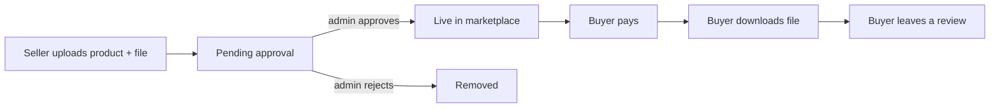

# AppBazaar

A digital marketplace where developers and studios sell software, apps, website templates, AI tools and services, and buyers pay and download what they bought.

Built with **Spring Boot 3 (Java 21)**, **PostgreSQL** and **React (Vite)**.


## Features

- **Registration fee.** Every new buyer and seller pays a one-time $5 fee (simulated for now) before the account is active. The admin panel shows the fee income.
- **Email and password login.** Sign up with an email and a password, then confirm the email once with a 6-digit code (it also lets you reset a forgotten password). Codes are stored hashed, expire in 10 minutes, and allow 5 tries. Passwords are hashed with BCrypt and wrong passwords are rate limited.
- **Three roles.** Buyer, seller and admin, with JWT login and role-based access on every endpoint.
- **Seller uploads.** A seller lists a product together with the file buyers will receive (zip, rar, 7z, tar, gz, pdf, apk, jar, txt, md, up to 50 MB).
- **Admin approval.** New listings wait in an approval queue. The admin can download the file to review it, then approve or reject. Only approved products are public.
- **Cart and checkout.** Prices are always read from the database, never from the browser. Payment is simulated for now.
- **Protected downloads.** Only a buyer who paid, the product's seller, or an admin can download a file. Files are stored under random names.
- **Real reviews.** Only buyers of a product can review it. A product's rating is the average of its real reviews.
- **Student projects group.** College and mini projects live together on a Projects page, with a separate Register your project form (tech stack, college, price and file).
- **Games.** Game source code and playable game builds have their own Games page and a Sell your game form. Selling game accounts, keys, in-game items or pirated games is not allowed.
- **Account page.** Every user can see their account details, change their display name and change their password.
- **UPI QR payments (India).** Buyers can pay in rupees by scanning a UPI QR code. They enter the transaction ID and an admin checks it before approving. PayPal stays available for international buyers.
- **Search and filters**, light and dark theme, and a responsive layout.

| Seller upload | Admin approval | Buyer downloads |
|---|---|---|
|  |  |  |

## How it works



## Tech stack

| Layer | Tools |
|---|---|
| Backend | Java 21, Spring Boot 3.3, Spring Security, Spring Data JPA (Hibernate), JJWT |
| Database | PostgreSQL |
| Frontend | React 18, React Router, Vite |
| CI | GitHub Actions (builds backend and frontend on every push) |

## Run it locally

You need Java 21, Maven, Node 18 or newer, and PostgreSQL.

1. **Database.** Create an empty database called `appbazaar`. (With Docker you can run `docker compose up -d` instead.)
2. **Backend.**
   ```
   cd backend
   mvn spring-boot:run
   ```
   Runs on http://localhost:8080. Tables are created automatically.
3. **Frontend.**
   ```
   cd frontend
   npm install
   npm run dev
   ```
   Open http://localhost:5173.

On Windows, `start-backend.ps1` and `start-frontend.ps1` do steps 2 and 3 for you.

### Seeded accounts

The admin account is created on first startup with the configured `ADMIN_PASSWORD`.
Sample sellers and listings require `SEED_DEMO_DATA=true`. Seeded seller accounts receive random passwords.

Everyone logs in with email and password. New buyers and sellers sign up on the Log in page ("Create an account"). Admin accounts cannot be created from the website.

### Configuration

Set these as environment variables.

| Variable | Default | Purpose |
|---|---|---|
| `DB_URL`, `DB_USER`, `DB_PASS` | localhost, `postgres`, `postgres` | PostgreSQL connection |
| `JWT_SECRET` | Required | Set a random value of at least 32 UTF-8 bytes |
| `ADMIN_PASSWORD` | Required | Set a strong password of at least 16 characters and at most 72 UTF-8 bytes |
| `SEED_DEMO_DATA` | `false` | Set to `true` locally to create demo sellers and listings |
| `PAYPAL_CLIENT_ID`, `PAYPAL_SECRET` | empty | PayPal app credentials. Both are required to enable PayPal |
| `UPI_ID`, `UPI_NAME`, `INR_PER_USD` | empty | UPI QR payments in rupees. Both `UPI_ID` and `INR_PER_USD` must be set to turn it on |
| `PAYPAL_BASE` | PayPal sandbox | Set to `https://api-m.paypal.com` for live payments |
| `FRONTEND_URL` | `http://localhost:5173` | Where PayPal sends the buyer back |
| `REGISTRATION_FEE` | `5` | Registration fee in whole US dollars |
| `SPRING_MAIL_HOST`, `SPRING_MAIL_PORT`, `SPRING_MAIL_USERNAME`, `SPRING_MAIL_PASSWORD` | empty | SMTP server that sends login codes. Empty means the code is printed in the backend console (development only) |
| `MAIL_FROM` | `no-reply@appbazaar.local` | Sender address (use your Gmail address with Gmail) |
| `CORS_ORIGIN` | `http://localhost:5173` | Allowed frontend origin |
| `UPLOAD_DIR` | `./uploads` | Folder for uploaded files when no cloud storage is set |
| `S3_BUCKET`, `S3_ENDPOINT`, `S3_REGION`, `S3_ACCESS_KEY`, `S3_SECRET_KEY` | empty | S3-compatible cloud storage for product files (needed on free hosting) |
| `BREVO_API_KEY` | empty | Sends login emails over HTTPS (needed on hosts that block SMTP) |

## Online payments with PayPal

With neither PayPal nor UPI configured, payments are unavailable by default. Set `DEMO_MODE=true` only for isolated development. To test PayPal:

1. Go to developer.paypal.com, log in with a PayPal account, open **Apps & Credentials**, switch to **Sandbox**, and create an app. Copy its **Client ID** and **Secret**.
2. Start the backend with `PAYPAL_CLIENT_ID` and `PAYPAL_SECRET` set. `start-backend.ps1` asks for them.
3. The $5 registration fee and cart checkout now open the PayPal payment page. Pay with a **sandbox personal account** (Developer dashboard, Testing tools, Sandbox accounts).

The server only counts a payment after asking PayPal that the order is completed, for the right amount and the right account, and it rebuilds the amount from its own product prices. PayPal sends the buyer back to `FRONTEND_URL` (default `http://localhost:5173`). For live payments set `PAYPAL_BASE=https://api-m.paypal.com` with live credentials, and add PayPal webhooks so orders are created even if the buyer closes the tab.

## UPI payments in rupees (QR code)

Set `UPI_ID` (your UPI address), `UPI_NAME` (name shown to payers) and `INR_PER_USD` (the rate you use to turn dollar prices into rupees, for example the current market rate). The Pay with UPI QR option then appears for the registration fee and for the cart.

This is a manual check, not a payment gateway: the buyer pays, types the UTR from their UPI app, and the admin compares it with the UPI app or bank statement before pressing Approve in the admin panel. For automatic confirmation you need a gateway such as Razorpay.

## API

| Method | Path | Who |
|---|---|---|
| POST | `/api/auth/signup`, `/api/auth/signup/verify` | public (sign-up with email code) |
| POST | `/api/auth/login` | public (email and password) |
| POST | `/api/auth/forgot`, `/api/auth/reset` | public (password reset with email code) |
| GET | `/api/products?q=&category=` | public (live products only) |
| GET | `/api/products/{id}` | public |
| POST | `/api/products` (multipart: name, category, price, description, file) | seller |
| GET | `/api/products/mine` | seller |
| GET, POST | `/api/products/{id}/reviews` | read: public. Write: buyer who paid |
| GET | `/api/auth/fee-info` | public |
| POST | `/api/auth/pay-fee` | newly registered account that has not paid yet |
| GET | `/api/payments/config` | public |
| POST | `/api/payments/fee-session`, `/api/payments/order-session`, `/api/payments/confirm` | logged in (PayPal on) |
| GET | `/api/upi/config` | public |
| POST | `/api/upi/start`, `/api/upi/{id}/submit` | logged in |
| GET | `/api/upi/mine` | logged in |
| GET, POST | `/api/admin/upi`, `/api/admin/upi/{id}/approve`, `/api/admin/upi/{id}/reject` | admin |
| POST | `/api/orders` | logged in (demo checkout, off when PayPal is on) |
| GET | `/api/orders/mine` | logged in |
| GET, PUT | `/api/account/me` | logged in (details, display name) |
| POST | `/api/account/password` | logged in (change password) |
| GET | `/api/files/{productId}` | buyer who paid, the seller, or admin |
| GET | `/api/admin/stats`, `/api/admin/pending` | admin |
| POST | `/api/admin/products/{id}/approve` | admin |
| DELETE | `/api/admin/products/{id}` | admin (pending only) |

## Project structure

```
backend/    Spring Boot API (model, repo, security, web, storage)
frontend/   React app (pages, auth and cart context, API helper)
docs/       Screenshots used in this README
```

## Deploy for free

See [DEPLOY.md](DEPLOY.md): Render (backend and frontend), Neon (database), Supabase Storage (product files) and Brevo (login emails).

## Roadmap

- PayPal webhooks for production, and Razorpay for payments in rupees
- Prices in cents, to support amounts like $9.99
- Email notifications for orders and approvals (the mail setup for login codes is already in place)
- More integration tests for the API and main user flows

## Author

Built by Ashish Patil as a full-stack portfolio project.

Released under the [MIT License](LICENSE).
